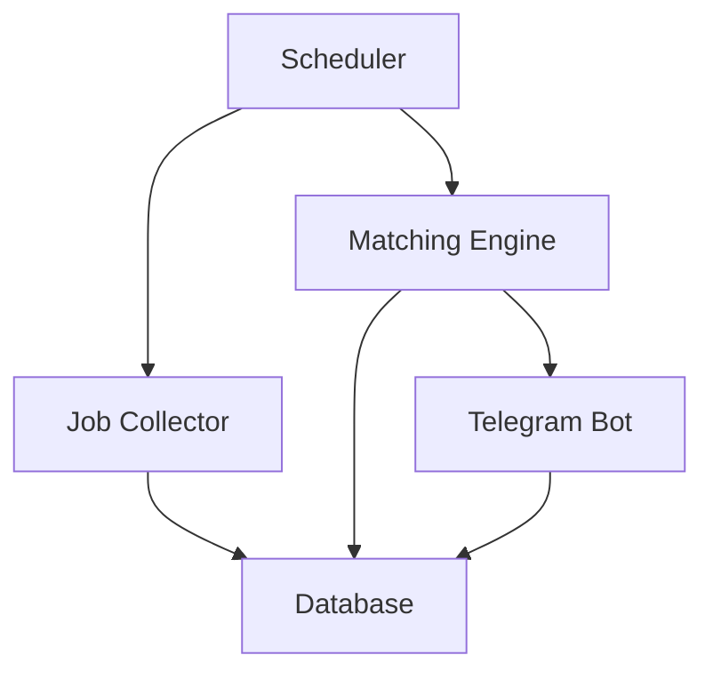

# MyJob

## Overview
MyJob is a **Telegram‑first** resume‑to‑job matching service. Candidates simply send their resume (PDF) to the bot and receive personalized job recommendations directly in the chat. The system continuously collects new technical job postings, clusters them using unsupervised learning, and matches each candidate profile to the most relevant clusters.

---

## Data Sources
The job collector fetches postings from several public applicant‑tracking system (ATS) APIs:

- **Lever** (company: Aleph)
- **Greenhouse** (company: Vercel)
- **Ashby** (company: Linear)
- **SmartRecruiters** (company: SmartRecruiters)
- **Career Pages** (e.g., AdEngage)

These sources are defined in `src/jobs/registry.py` and are queried regularly by the scheduler.

---

## Tech Stack
- **Text Extraction:** PDF resumes are parsed with **PyMuPDF** to obtain raw text.
- **Embedding & Semantic Matching:** Job descriptions and candidate profiles are encoded using a **pre‑trained sentence‑transformer model** (e.g., `all‑MiniLM‑L6‑v2`) via the **Transformers** library.
- **Unsupervised Clustering:** The embeddings are grouped with **HDBSCAN**, providing flexible cluster counts and handling noise.
- **Scheduler:** A lightweight Python scheduler (`src/jobs/scheduler.py`) runs an infinite loop with configurable interval (`SYNC_INTERVAL_HOURS`) and triggers the job sync and clustering pipeline.
- **Database:** **PostgreSQL** stores users, profiles, jobs, and matches; SQLAlchemy is used as the ORM.

---

## Architecture
The solution consists of four loosely coupled components that communicate through a shared PostgreSQL database:

1. **Telegram Bot Service** – Handles user interactions, receives resumes, extracts text, creates candidate profiles, and delivers match notifications.
2. **Job Collector & Normalizer** – Periodically scrapes or imports job listings, normalises fields, and stores them in the database.
3. **Matching Engine** – Embeds job descriptions, performs unsupervised clustering, and evaluates similarity between a candidate profile and the clustered jobs.
4. **Scheduler** – Orchestrates regular syncs (job collection, clustering, matching) and triggers the bot to send updates.



---

## Data Pipeline
The end‑to‑end flow of a candidate’s resume through the system:

1. **Resume Upload** – User sends a PDF to the Telegram bot.
2. **PDF Extraction** – Text is extracted and transformed into a **candidate profile** (skills, experience, etc.).
3. **Job Collection** – Scheduler triggers collectors that fetch the latest job postings from configured sources.
4. **Job Normalisation** – Raw postings are cleaned, fields are standardised, and stored.
5. **Embedding & Clustering** – All job descriptions are embedded and grouped with an unsupervised clustering algorithm (HDBSCAN).
6. **Similarity Matching** – The candidate profile is compared against the clustered jobs to find the most relevant matches.
7. **Notification** – Top‑N matching jobs are sent back to the user via Telegram.

---

## PostgreSQL Database
The database stores the core entities used throughout the pipeline.

### Jobs
Key fields include:
```
id
source_job_id
title
company
location
description
skills
experience_required
employment_type
application_url
source
source_type
fingerprint
status
first_seen_at
last_seen_at
closed_at
source_company
missed_runs
```

### Job Matches
Records the matching result for each candidate‑job pair:
```
match_score
matched_skills
missing_skills
role_score
skill_score
experience_score
semantic_score
application_url
```

### Collection Runs
Tracks each job‑collection attempt:
```
source
source_company
started_at
finished_at
jobs_found
success
error_message
```

---

## Module Overview
| Package | Responsibility |
|---------|----------------|
| `src/notifications` | Telegram bot implementation, message handling, and user‑facing notifications. |
| `src/database` | ORM models, repository helpers for users, profiles, jobs, and matches. |
| `src/jobs` | Scheduler and job‑collector wrappers that periodically sync external listings. |
| `src/matching` | Embedding generation, unsupervised clustering, and similarity scoring logic. |
| `src/ml` | Utilities for loading pre‑trained language models and vector operations (kept internal). |

---

## Getting Started
1. **Clone the repository**
   ```bash
   git clone <repo-url>
   cd myjob
   ```
2. **Create a virtual environment & install dependencies**
   ```bash
   python -m venv .venv
   .venv\Scripts\activate
   pip install -r requirements.txt
   ```
3. **Configure environment variables** – copy `.env.example` to `.env` and fill in the values (PostgreSQL connection, Telegram bot token, etc.).

---

## Running the System
```bash
# Start the Telegram bot (runs in background)
python -m src.notifications.bot_service &

# Start the scheduler to keep jobs and matches up‑to‑date
python -m src.jobs.scheduler
```
The bot will listen for resume uploads and automatically push match notifications. The scheduler ensures the job catalogue stays fresh and clustering is refreshed regularly.

---

## Contributing
Contributions are welcome! Please open a pull request with a clear description of the change. Follow the existing code style and run the test suite (`pytest`) before submitting.

---

## License
Distributed under the MIT License. See `LICENSE` for more information.
